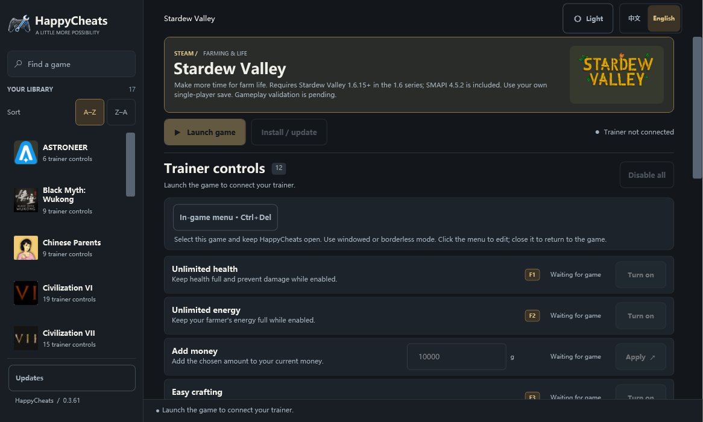

# HappyCheats

A Windows trainer library with 17 games, English / 中文, and one shared in-game menu.

**[Download HappyCheats.exe](https://github.com/flazedude/happycheats/releases/latest/download/HappyCheats.exe)** · [Latest release](https://github.com/flazedude/happycheats/releases/latest) · [Changelog](CHANGELOG.md) · [中文说明](README.zh-CN.md)

## Latest version · 0.3.62

All controls stay clickable, including while disconnected or busy. Failed attempts show an error and write to the local client error log. The desktop and shared in-game menu use the same behavior across all 17 games; trainer payloads are unchanged.

[Full release notes](docs/releases/0.3.62.en.txt)

*Client screenshot; no game is running.*

## Get started

1. Download **HappyCheats.exe** above and run it on **Windows x64**. The complete app and all trainer payloads are included; the launcher needs no separate .NET installation.
2. Select your game. Steam installations are detected automatically; use **Browse** if yours is missing.
3. With the game closed, choose **Install / update** and follow any game-specific setup instructions.
4. Choose **Launch game**, then load a save or character. If the game page offers **Connect trainer**, select it after loading.
5. Wait for a connected/ready status, then use the controls or the hotkeys shown beside them. Keep HappyCheats running with your game selected.

The app starts in Chinese. Select **English** at the top to switch; your choice is saved.

## Keyboard & controller

| Action | Shortcut |
| --- | --- |
| Show / hide the shared in-game menu | **Ctrl+Del** |
| Show / hide with an Xbox/XInput controller | Enable **Xbox shortcuts**, then **hold Menu (☰) for 350 ms and tap RB** |
| Change a cheat or enter a value | Use the **mouse and keyboard** in the client or shared menu |
| Use game-specific cheat shortcuts | Follow the mappings shown on the selected game page |

Use **windowed or borderless** mode for the shared menu; exclusive fullscreen is unsupported. The controller chord only opens or closes the menu and does not provide row navigation. Opening the menu does not enable cheats. [More about the in-game menu](docs/in-game-menu.md)

## Games & setup

Compatibility and available controls depend on the game build. Some trainers are experimental; each guide records its requirements and validation status.

| Game | Game | Game |
| --- | --- | --- |
| [ASTRONEER](docs/astroneer.md) | [Black Myth: Wukong](docs/wukong.md) | [Chinese Parents](docs/chinese-parents.md) |
| [Civilization VI](docs/civilization-vi.md) | [Civilization VII](docs/civilization-vii.md) | [Crimson Desert](docs/crimson-desert.md) |
| [Elden Ring](docs/elden-ring.md) | [GTA V Enhanced · Story Mode](docs/gta-v-enhanced.md) | [Hotel Architect](docs/hotel-architect.md) |
| [Laundry Store Simulator](modules/laundry/README.md) | [Onimusha: Way of the Sword](docs/onimusha.md) | [Phantom Blade Zero](docs/phantom-blade.md) |
| [Project Hospital](docs/project-hospital.md) | [Red Dead Redemption 2 · Story Mode](docs/rdr2.md) | [Stardew Valley](docs/stardew.md) |
| [The Blood of Dawnwalker](docs/dawnwalker.md) | [The Witcher 3: Wild Hunt — Remastered](docs/witcher-3.md) | |

Use the supported single-player/offline modes described in each guide. Progression and resource changes may be saved by the game; turning a cheat off does not undo earlier changes.

## Updates & help

HappyCheats checks for signed updates and downloads them in the background. Open **Updates** for progress and release notes, then choose **Restart & install** when ready. After a trainer changes, close its game and choose **Install / update** on that game's page.

[Report an issue](https://github.com/flazedude/happycheats/issues) with your HappyCheats version, game version, and the status/error shown in the app.

[Update help](docs/updates.md) · [Development](docs/development.md) · [Validation details](docs/validation.md)
