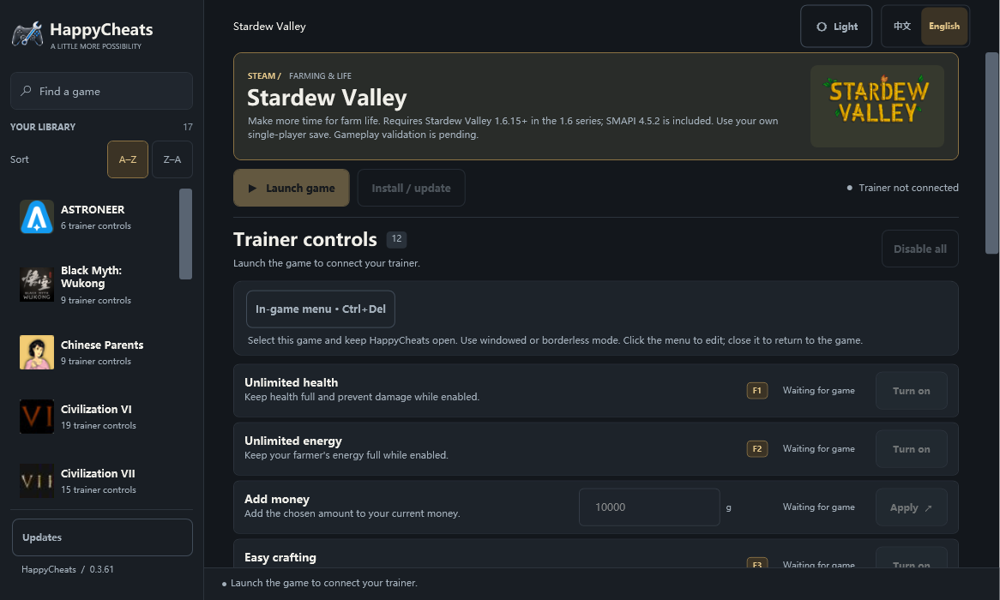

# HappyCheats

Windows 游戏修改器合集，支持 20 款游戏（内置 17 款，甜蜜冰淇淋、Nomad Drive 和生存日志通过独立包添加）、中英双语和统一游戏内菜单。

**[下载 HappyCheats.exe](https://github.com/flazedude/happycheats/releases/latest/download/HappyCheats.exe)** · [最新发行版](https://github.com/flazedude/happycheats/releases/latest) · [更新日志](CHANGELOG.md) · [English](README.md)

## 最新版本 · 0.3.69

所有修改器会在加载、地点或会话变化时保留已开启功能的请求，并在新会话验证通过后恢复；关闭功能或“全部关闭”会取消恢复。黎明行者之血同时修复生命与耐力锁定失效后自动关闭的问题，F4 改为持续恢复血量与耐力。新效果尚待游戏内验证。

[完整更新说明](docs/releases/0.3.69.zh.txt)

**新增独立修改器：[甜蜜冰淇淋 1.0.0](docs/livin-cream.md)** — 金钱、店铺经验、技能点、顾客耐心和软冰淇淋原料。客户端 0.3.69 的更新列表会隐藏未知游戏，首次添加请使用说明中的签名包安装助手；后续使用修改器库的正常“更新”。客户端 EXE 与版本不变。已完成离线/静态/合成验证，实际游戏效果与加载器启动尚未验证。

*客户端截图，未运行游戏。*

生存日志独立修改器包 **1.0.0** 支持 Steam **26294912**。首次请关闭客户端及游戏后运行 `scripts/Add-SurvivalLog.ps1`，后续使用**修改器库 → 更新**。0.3.69 启动EXE不变；请使用已签名游戏包添加支持。[功能与验证范围](docs/survival-log.md)

## 开始使用

1. 下载上方的 **HappyCheats.exe**，在 **Windows x64** 上运行。包含完整客户端及该版本内置修改器；通过修改器库“更新”添加新游戏。启动器无需单独安装 .NET。
2. 选择游戏。Steam 安装路径会自动识别；未找到时使用“浏览”手动选择。
3. 保持游戏关闭，点击“安装 / 更新”，按游戏页面的提示完成设置。
4. 点击“启动游戏”，载入存档或角色。若页面提供“连接修改器”，请在载入后点击。
5. 等待状态显示已连接 / 就绪，再使用功能按钮或旁边标注的快捷键。保持 HappyCheats 运行，并选中当前游戏。

客户端默认中文；点击顶部的 **English** 可切换语言，选择会自动保存。

## 键盘与手柄

| 操作 | 快捷键 |
| --- | --- |
| 显示 / 隐藏统一游戏内菜单 | **Ctrl+Del** |
| 使用 Xbox/XInput 手柄显示 / 隐藏菜单 | 启用“Xbox 手柄快捷键”，**按住 Menu（☰）350 毫秒，再点按 RB** |
| 切换功能或输入数值 | 使用**鼠标和键盘**操作客户端或统一菜单 |
| 使用游戏专属功能快捷键 | 查看当前游戏页面显示的按键映射 |

统一菜单支持**窗口 / 无边框模式**，不支持独占全屏。手柄组合键只负责显示或隐藏菜单，不提供菜单行导航。打开菜单不会自动开启功能。[游戏内菜单说明](docs/in-game-menu.md)

## 游戏与设置

兼容性和可用功能取决于游戏版本。部分修改器为实验性功能；各游戏说明中列出了要求和验证范围。

| 游戏 | 游戏 | 游戏 |
| --- | --- | --- |
| [异星探险家 ASTRONEER](docs/astroneer.md) | [黑神话：悟空](docs/wukong.md) | [中国式家长](docs/chinese-parents.md) |
| [文明 VI](docs/civilization-vi.md) | [文明 VII](docs/civilization-vii.md) | [红色沙漠](docs/crimson-desert.md) |
| [艾尔登法环](docs/elden-ring.md) | [GTA V Enhanced · 故事模式](docs/gta-v-enhanced.md) | [酒店建筑师](docs/hotel-architect.md) |
| [洗衣店模拟器](modules/laundry/README.md) | [鬼武者：剑之道](docs/onimusha.md) | [影之刃零](docs/phantom-blade.md) |
| [医院计划 Project Hospital](docs/project-hospital.md) | [荒野大镖客 2 · 故事模式](docs/rdr2.md) | [星露谷物语](docs/stardew.md) |
| [黎明行者之血](docs/dawnwalker.md) | [巫师 3：狂猎 — 重制版](docs/witcher-3.md) | [甜蜜冰淇淋：冰淇淋店模拟器](docs/livin-cream.md) |
| [Nomad Drive · 独立模块](docs/nomad-drive.md) | [生存日志 · 独立模块](docs/survival-log.md) | [Builder Simulator · 独立模块](docs/builder-simulator.md) |

请使用各游戏说明中支持的单人 / 离线模式。资源和进度改动可能被游戏保存；关闭功能不会撤销之前的改动。

## 更新与帮助

HappyCheats 会检查签名更新并在后台下载。打开“客户端更新”查看进度和更新说明，准备好后选择“重启并安装”。修改器内容更新后，请先关闭对应游戏，再点击该游戏页面的“安装 / 更新”。

遇到问题可[提交反馈](https://github.com/flazedude/happycheats/issues)，附上 HappyCheats 版本、游戏版本以及客户端显示的状态或错误。

[更新帮助](docs/updates.md) · [开发说明](docs/development.md) · [验证记录](docs/validation.md)
